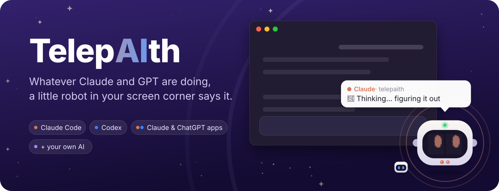
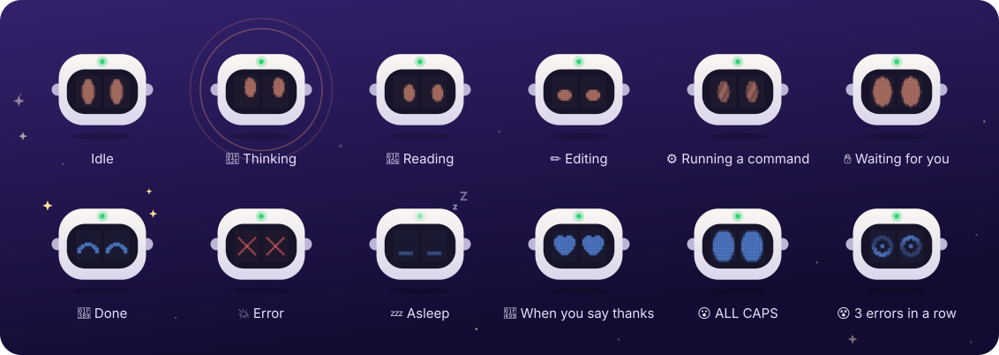
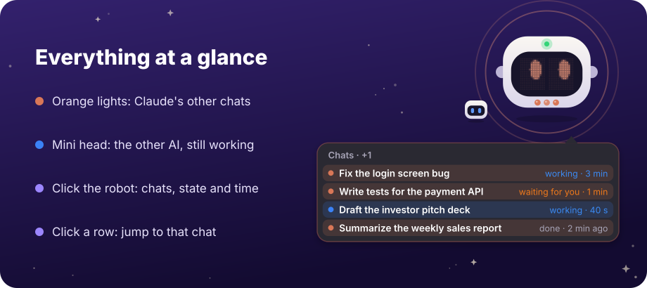
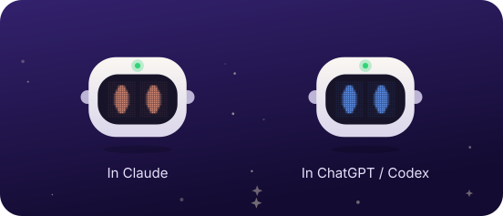
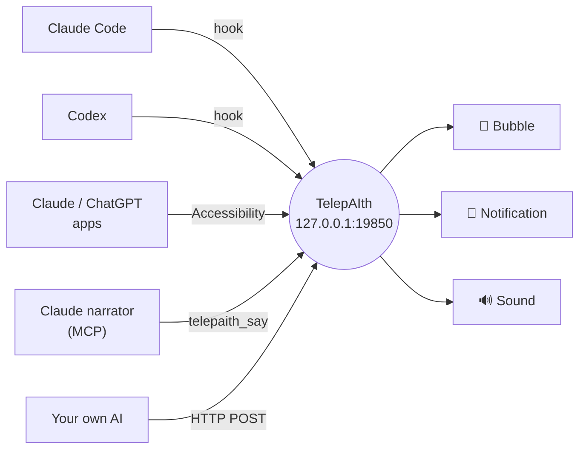

<p align="right"><a href="README.md">Türkçe</a> · <b>English</b></p>

<p align="center">
  
</p>

<p align="center">
  <a href="https://github.com/onurerensavci/TelepAIth/releases/latest"></a>
  <a href="https://github.com/onurerensavci/TelepAIth/releases/latest/download/Windows-TelepAIth-x64.zip"></a>
</p>

<p align="center">
  <a href="https://github.com/onurerensavci/TelepAIth/releases/latest"></a>
  <a href="https://github.com/onurerensavci/TelepAIth/releases"></a>
  
  <a href="https://github.com/onurerensavci/TelepAIth/actions/workflows/build.yml"></a>
</p>

**TelepAIth** is a tiny robot head with LED dot-matrix eyes that floats in the corner of your screen. It reads what Claude and GPT are doing right now and says it in a speech bubble above its head, and it notifies you when a task finishes or the AI is waiting for you. Its eyes glow orange in Claude and blue in GPT. It works with Claude Code, Codex and the Claude and ChatGPT desktop apps, and you can hook up any other AI too.

<p align="center">
  
</p>

## What it does

**👀 Follows along**
- **Claude Code and Codex:** sees every step as it happens: reading files, searching, editing, running commands, handing work to a subagent…
- **Claude and ChatGPT apps:** tells from the on-screen Stop / Allow buttons when the AI is working, waiting for approval or done, and sums up the phase in a word or two: *looking, solving, understanding, finishing*.
- **Switching chats** follows the chat you clicked instead of calling the old one "done".
- **Background chats:** when you move to another chat in Claude, chats still running in the background are picked up from the sidebar: the robot shows as working, and you're told when they finish or need your answer (while the sidebar is open). The robot recognises the sidebar by its structure; it never reads or clicks the messages inside a chat.
- **Apps whose screen can't be read** (e.g. ChatGPT on Mac): the robot first asks the app to expose its screen; if it still can't read it, it guesses whether it's working from CPU usage (Diagnostics says "guessing from CPU").
- **Two AIs at once:** while one is in the big head, the other (e.g. ChatGPT when Claude is shown) appears as a single mini head next to it, with an orange dot if it's waiting for you. If the AI in the big head has more chats running, small lights in its color glow under the robot's screen (Claude orange, GPT blue); one waiting for you blinks fast. Up to 4 dots show; with more chats, the 4th dot gets a "+".
- **Narrator:** optionally, Claude tells the robot what it's doing in its own words (a small MCP tool).
- **Quota:** if ClaudeBar is installed, warns you when your quota runs low, and a thin ring around the robot shows what's left.

**🗂️ Never lose a chat**
- **Click the robot:** the bubble opens a Chats list: every chat that's working, waiting for you or done, Claude and ChatGPT together. The header sums it up (*1 waiting · 1 new · 2 working*).
- **Colour code:** orange needs you, green just finished, red error, grey a finished chat you've already seen; a light sweeps over working rows. A thin stripe on the left shows which AI it is (Claude orange, GPT blue), and the time is on the right (*waiting · 2 min*, *40 s*, *5 min ago*).
- **Click a row and that exact chat opens:** Claude chats open directly through the official `claude://` link. For chats without a link, the robot presses that chat in the sidebar and checks it opened; if it can't find it, it tells you.
- **Lots of chats:** 6 rows show at a time; scroll inside the bubble for the rest. Finished chats stay listed for 2 hours, and the list stays open while your mouse is over it.
- **Real names:** the open chat's name is picked up from the sidebar right away (no more "Open chat"), and suffixes Claude adds like *Running* or *Includes an artifact* are cleaned off.

<p align="center">
  
</p>

**💬 Talks**
- Speaks with an emoji for each action: 🔮 thinking, 📖 reading, 🧪 running tests, 📦 installing packages, 🚀 on `git push`, 🎉 when done, ✋ when waiting for you.
- Wraps up each turn: *Done! · 2 min · 12 tools · 4 edits*.
- Has moods: heart eyes when you say thanks, shocked by ALL CAPS, scared of `rm -rf`, throws a party when tests pass, gets dizzy after 3 errors in a row.
- Its eyes talk: they show ? (asking), ! (needs approval), ✓ (done) and % (quota low). When idle its eyes follow your cursor and it smiles when you hover; click it rapidly and it gets dizzy.
- **Effects:** snow, sun, rainbow, northern lights, stars, hearts, bubbles, fireflies, rain, autumn leaves or confetti around the robot (11 effects). On *Automatic* it follows the season (snow and a beanie in winter, a rainbow in spring, sun in summer, leaves in autumn), shows hearts when love comes up in a chat and confetti for celebrations. Robot's room → Effects.
- Speaks Turkish or English. Can read things out loud and play short sounds if you like.

**🔔 Lets you know**
- **The robot tells you first:** when a task finishes, when the AI needs your approval or an answer, and on errors, the robot says it in its bubble. You can also turn on system notifications (Settings → Notifications, off by default): chats waiting for you, errors and alerts then arrive as notifications too. Finished chats don't send a notification; the robot tells you.
- **Sound settings:** in Settings → Sound you choose when it makes a sound: when a task finishes, when it needs you, reminders, working in the background, errors, usage limits, smart alerts, the daily summary.
- Kept quiet: background chats don't notify while that app is in front (the robot says it in its bubble); on Mac the notification sound plays at most once every 10 seconds; a "done" guessed from CPU usage doesn't notify.
- **Mute:** right-click the robot → 🔇 *Mute*. Notifications arrive silently, the robot makes no sounds and doesn't speak; unmute from the same place.
- **Click a notification or the bubble** to jump to that chat: Claude, ChatGPT, or the terminal Claude Code runs in.
- **Nags when it should:** if the AI waits more than 30 seconds for your OK, the robot wiggles now and then with a "!" on its head, and reminds you once more after 2 minutes.
- **Focus mode:** in meetings (Zoom/Teams in front, or the microphone in use) or when you turn it on, the robot dims and goes quiet, telling you only what needs you.
- **Daily summary:** in the evening, a short recap like "Claude: 14 tasks, 2 h 10 min, 31 edits".
- **Shield:** before Claude Code runs something risky like `rm -rf`, `git push --force`, `git reset --hard`, `DROP TABLE`, `curl … | sh` or `terraform destroy`, it asks you first (it doesn't block, it just asks).
- **Safe approvals from the bubble:** *Allow* only shows for a short, one-line command you can read whole in the bubble. A file edit or a long command can only be denied from the bubble; to approve it, go to the terminal.
- **Usage limits:** Claude Code's session (5-hour) and weekly limits become two small rings at the robot's feet, and the chat list starts with *Session 42% · full at 16:40*. It tells you at 80%, at 95% and when a limit resets. Settings → Coding agents → *Usage limits* (uses Claude Code's status line; yours keeps showing).
- **Smart alerts:** says *looks stuck* when a chat fails the same step 3 times in a row; warns when two chats edit the same file; after Claude runs `git push` it watches that commit's CI and says *CI passed* / *CI failed* (needs `gh`); when a turn ends with work left uncommitted for 1.5 hours, it reminds you once.
- **Easy on the battery:** when idle the robot settles and stops redrawing (only a few frames to blink); it springs back the moment something happens. With *reduce motion* on, it doesn't bob.
- **The robot's room:** from the menu or right-click the robot → *🏠 Robot's room*. The robot, its level and streak on the left; five tabs on the right:
  - **Wardrobe:** 30 pieces in 5 slots: Head, Glasses, Face, Neck and Beside. Pick anything from each slot to make your own combo (headphones, a beanie, aviators, a mustache, a scarf, a rubber duck or a rocket beside it…). Pieces unlock as it levels up or with achievements, and every slot hides a shiny legendary reward. The robot celebrates and tells you when one unlocks.
  - **Effects:** pick the effect around the robot, or leave it on *Automatic*.
  - **Achievements:** it earns XP from real work (turns, edits, minutes worked, active days); 31 achievements like *Chatty*, *Big day*, *Night owl*, *Team lead*. The robot tells you when one unlocks.
  - **Effort:** how long each AI and each project worked over the last 7 days, 30 days or all time: a daily chart and a project table.
  - **Usage:** session and weekly limits as big rings, plus today's turns and time per AI.
- **Hide:** drag the robot off the bottom of the screen and only the top of its head peeks out. Click it, or let news come, and it's back.

**🪄 Knows its place**
- Click Claude or ChatGPT and it flies to the bottom-right corner of that window, and follows if you move the window. Switch to other apps and it stays put.
- Stays on whichever desktop (Space) the AI is on.
- Snaps to screen corners and moves between monitors.
- **🔒 Lock** pins it in place, **📌 Always on top** keeps it above every window. It can also sit over the menu bar (the taskbar on Windows).
- **Size:** Settings → General → Robot size: Small, Medium, Large, Extra large. Handy on big monitors.
- **Updates itself:** checks for a new version every half hour. When there is one, the light on its forehead turns orange; click the robot or right-click → *⬆️ Update* and it installs without asking, then tells you what's new.

<p align="center">
  
</p>

## Install

1. **[Download the DMG](https://github.com/onurerensavci/TelepAIth/releases/latest/download/TelepAIth.dmg)**, open it and drag `TelepAIth` into **Applications**. (Prefer a zip? [TelepAIth.zip](https://github.com/onurerensavci/TelepAIth/releases/latest/download/TelepAIth.zip).)
   <details><summary>With Homebrew</summary>

   ```bash
   brew tap onurerensavci/telepaith https://github.com/onurerensavci/TelepAIth
   brew install --cask telepaith
   ```
   Installed with Homebrew, you can skip the "Open Anyway" step below.
   </details>
2. **First launch:** the app isn't notarized by Apple, so macOS blocks the first launch. Go to **System Settings → Privacy & Security** and click **Open Anyway** next to TelepAIth at the bottom.
   <details><summary>One line in Terminal</summary>

   ```bash
   xattr -dr com.apple.quarantine /Applications/TelepAIth.app && open /Applications/TelepAIth.app
   ```
   </details>
3. **Setup assistant:** on first launch a window walks you through notification permission, Accessibility permission (for the Claude and ChatGPT apps) and connecting Claude Code / Codex, and introduces notifications, sound, the wardrobe and effects. Reopen it any time from the menu → **Setup assistant…**.
4. **Connections** (menu → **Settings… → Connections**):

| Connection | What it does | Note |
|---|---|---|
| **Claude and ChatGPT apps** | Watches the desktop apps on screen | Needs Accessibility permission, on by default |
| **Claude Code** | Adds hooks to `~/.claude/settings.json` | New sessions start reporting |
| **Codex** | Adds hooks to `~/.codex/hooks.json` | Type `/hooks` in Codex once and approve |
| **Narrator** | Adds the `telepaith_say` tool to Claude desktop | Restart Claude, paste the shown instruction into Claude → Settings → Your Claude → Instructions |
| **ClaudeBar** | Receives quota alerts | ClaudeBar → Webhooks → `http://localhost:19850/claudebar` (JSON) |

Hooks back up your settings files, only touch their own entries and send events in the background, so they don't slow Claude Code or Codex down. Turn them off in Settings to remove them.

To try it out: menu → **Try it → Claude: a short task**. You'll see the robot think, read, edit and hop.

### Windows (experimental)

The first trial build for Windows 10 and 11. Same as on the Mac: the robot, the chat list, watching the Claude/ChatGPT desktop apps, flying to their window, the robot's room and effects, focus mode, mini heads, daily summary.

1. **[Download the Windows package](https://github.com/onurerensavci/TelepAIth/releases/latest/download/Windows-TelepAIth-x64.zip)**, unzip it into a folder and double-click `TelepAIth.exe`.
2. If Windows says **"Windows protected your PC"**: **More info → Run anyway**. (The app isn't signed; you'll see this once.)
3. TelepAIth installs itself to `%LOCALAPPDATA%\Programs\TelepAIth`, adds a Start menu entry and starts with Windows. You can delete the downloaded folder afterwards.
4. The setup assistant opens. The robot lives in the taskbar tray icon: right-click → **Settings**. No extra permission is needed on Windows.

If something goes wrong, right-click the robot → **Report a problem…**: it opens a GitHub issue filled with diagnostics. To uninstall: tray icon → **Help → Uninstall TelepAIth…**.

## Talking to the robot

| Action | What happens |
|---|---|
| **Click** | Opens the Chats list (click again to close). If the light is orange it installs the update, if red it tells you what's broken. |
| **Click a row in the list** | Opens that exact chat. |
| **Scroll over the list** | Scrolls when there are more than 6 chats. |
| **Click the bubble** | Jumps to that task's window (Claude, ChatGPT or your terminal). |
| **Double-click** | Brings the AI app it's showing to the front. |
| **Drag** | Moves it. Drop it near a corner to snap there, or onto another monitor. |
| **Right-click** | ⬆️ Update (when available) · 🔒 Lock · 🔇 Mute · 🌙 Focus mode · 📌 Always on top · 🏠 Robot's room · 📊 Today's summary · ⚙️ Settings · 🔄 Check for updates · 🧰 More (🕘 Recent events, 🩺 Diagnostics, 🐞 Report a problem, 🙈 Hide) |

**Forehead light:** 🟢 all good · 🟠 update available · 🔴 something's broken (click and it'll tell you why).

## How it works



TelepAIth runs a small local server on your Mac. Hooks, the narrator and your own tools send events to it. Desktop apps are read through the macOS Accessibility API, from their on-screen buttons and status line.

## Privacy

Everything stays on your Mac. The server only accepts requests from this computer and rejects requests from web pages. Text read from the screen is never sent anywhere. The only outgoing connection is the update check that asks GitHub whether a new version is out.

## Connect your own AI

Any tool can send the robot an event with a single `POST`. A new `source` shows up on its first event. Gemini comes in purple; give others a color in [Settings](#settings).

```bash
curl -s -H 'Content-Type: application/json' \
  -d '{"state":"running","text":"Running the tests","project":"app"}' \
  "http://127.0.0.1:19850/event?source=gemini"
```

<details><summary>Fields</summary>

| Field | Description |
|---|---|
| `state` | `idle`, `thinking`, `reading`, `searching`, `editing`, `running`, `delegating`, `waiting`, `done`, `error` |
| `text` | Text shown in the bubble |
| `project` | Small caption in the bubble (optional) |
| `session` | Tells apart multiple sessions of the same AI (optional) |
| `notify` | If `true`, a `done` event notifies right away |
| `emoji` | Emoji put before the text (optional, picked from the state otherwise) |

JSON in the Claude Code / Codex hook format (with `hook_event_name`) is accepted too. If the port is taken the next one is used; the current port is in `~/.telepaith/port`. Quick test: `scripts/send-test.sh gemini done "All green"`.
</details>

## Settings

<details><summary>Colors and app mapping</summary>

`~/.telepaith/config.json` (menu → Open settings folder):

```json
{
  "longTurnSeconds": 20,
  "sources": {
    "claude": { "name": "Claude", "color": "#D97757" },
    "gpt":    { "name": "GPT",    "color": "#3B82F6" },
    "gemini": { "name": "Gemini", "color": "#8B5CF6" }
  },
  "apps": { "com.example.app": "gemini" }
}
```

`apps` maps an app (bundle id) to an AI. After editing, menu → **Reload colors and skins**.
</details>

<details><summary>Skins: dress the robot in your own art</summary>

The robot is drawn in code by default. To use your own character:

1. Generate a 5×2 sheet of heads with the prompt in [`docs/GORSEL-PROMPT.md`](docs/GORSEL-PROMPT.md) (transparent background).
2. Save the orange version as `~/.telepaith/skins/claude/sheet.png` and the blue one as `~/.telepaith/skins/gpt/sheet.png`.
3. Menu → **Reload colors and skins**.

Sheet order: row 1 `idle, thinking, reading, searching, editing`; row 2 `running, waiting, done, error, sleeping`. You can also drop single files like `idle.png` or `waiting.png`; they override the sheet. Without a source folder, `skins/default/` is used.
</details>

## Troubleshooting

<details><summary>The light is red</summary>

Click the robot and it tells you what's missing. Usually it's Accessibility: TelepAIth must be on in System Settings → Privacy & Security → Accessibility. If it looks on but stays red, click the robot or use the warning in the menu to reset the permission and grant it again.
</details>

<details><summary>No notifications</summary>

Menu → **Settings… → Notifications** shows the macOS permission status; if it's off, use "Open System Settings" to allow notifications for TelepAIth, then press **Send a test notification**. Note: you get no notification while you're already looking at that app, unless you turn on "Notify even while I'm looking at that app". In focus mode only things that need you are notified.
</details>

<details><summary>Nothing happens in the ChatGPT or Claude app</summary>

While the AI is answering, right-click the robot → **Report a problem…**. A pre-filled GitHub issue opens (text read from the screen is left out; the full report is copied to your clipboard). It shows what the robot can and can't see in that window, which is the fastest way to fix detection.
</details>

<details><summary>Silent in Claude Code or Codex</summary>

Make sure the item is on in menu → Settings → Connections. Hooks kick in for new sessions, so restart the open one. In Codex, type `/hooks` once and approve the TelepAIth hooks.
</details>

<details><summary>The robot is gone</summary>

Menu → **Show robot** or **Bring robot to this desktop**. If it's locked, it may be on another desktop.
</details>

<details><summary>Uninstall</summary>

Turn off the active items in menu → Settings → Connections (hooks and the narrator are removed), move the app to the Trash, and delete `~/.telepaith` if you like. Installed with Homebrew: `brew uninstall --cask telepaith`.
</details>

## Development

Building from source, running tests and releasing: [docs/GELISTIRME.md](docs/GELISTIRME.md) (Turkish).

```bash
git clone https://github.com/onurerensavci/TelepAIth.git && cd TelepAIth
scripts/build-app.sh && open build/TelepAIth.app
```

<p align="center"><sub>Inspired by <a href="https://github.com/oztrkemree/mochi">mochi</a> and <a href="https://github.com/tddworks/claudebar">ClaudeBar</a>.</sub></p>
