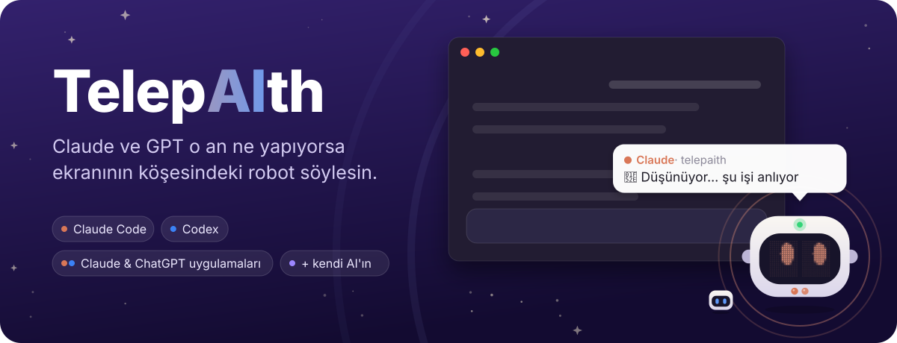
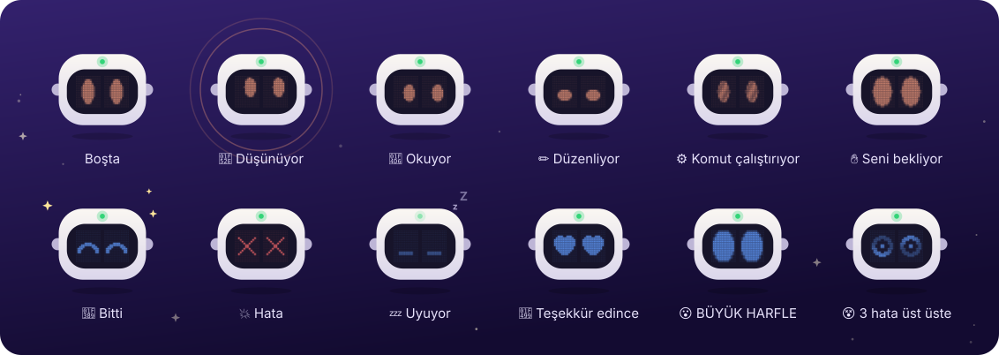
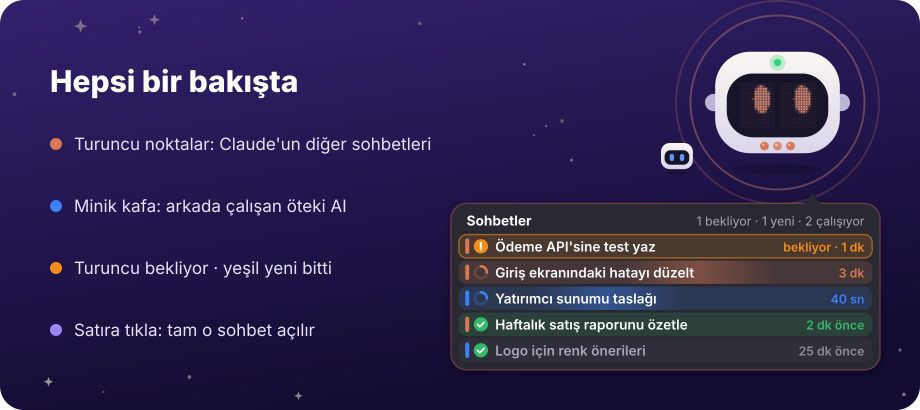
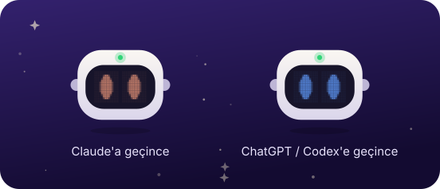
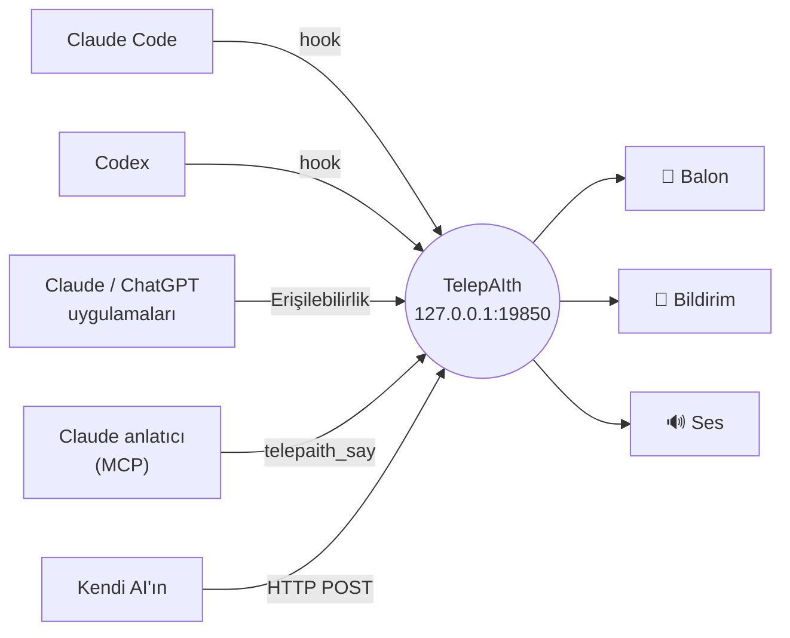

<p align="right"><b>Türkçe</b> · <a href="README.en.md">English</a></p>

<p align="center">
  
</p>

<p align="center">
  <a href="https://github.com/onurerensavci/TelepAIth/releases/latest"></a>
  <a href="https://github.com/onurerensavci/TelepAIth/releases/latest/download/Windows-TelepAIth-x64.zip"></a>
</p>

<p align="center">
  <a href="https://github.com/onurerensavci/TelepAIth/releases/latest"></a>
  <a href="https://github.com/onurerensavci/TelepAIth/releases"></a>
  
  <a href="https://github.com/onurerensavci/TelepAIth/actions/workflows/build.yml"></a>
</p>

**TelepAIth**, ekranının köşesinde süzülen, LED nokta gözlü küçük bir robot kafası. Claude ve GPT o an ne yapıyorsa okur, başının üstündeki balonda söyler. İş bitince ya da AI seni beklerken bildirim atar. Claude'dayken gözleri turuncu, GPT'deyken mavi yanar. Claude Code, Codex, Claude ve ChatGPT masaüstü uygulamalarıyla çalışır, istediğin başka bir AI'ı da bağlayabilirsin.

<p align="center">
  
</p>

## Neler yapar?

**👀 Takip eder**
- **Claude Code ve Codex:** her adımı anında görür: dosya okuyor, arıyor, düzenliyor, komut çalıştırıyor, alt ajana iş veriyor…
- **Claude ve ChatGPT uygulamaları:** ekrandaki Durdur / İzin ver düğmelerinden AI'ın çalıştığını, onay beklediğini ve bitirdiğini anlar. Ne aşamada olduğunu kısaca söyler: *bakıyor, çözüyor, anlıyor, bitiriyor*.
- **Sohbet değiştirince** tıkladığın sohbete geçer, eskisini "bitti" sanmaz.
- **Arkadaki sohbetler:** Claude'da başka bir sohbete geçsen de, arkada çalışmaya devam eden sohbetleri yan menüdeki durum noktasından görür: robot çalışıyor görünür, bitince ya da cevabını bekleyince haber verir (yan menü açıkken).
- **Ekranı okunamayan uygulamalar** (ör. Mac'te ChatGPT): robot önce uygulamadan ekranını açmasını ister; yine okuyamazsa çalışıp çalışmadığını işlemci kullanımından tahmin eder (Teşhis'te "işlemciden tahmini" yazar).
- **İki AI birden:** büyük kafada biri görünürken öteki (ör. Claude büyükse ChatGPT) yanında tek bir minik kafa olur; seni bekliyorsa üstünde turuncu bir nokta yanar. Büyük kafadaki AI'ın başka sohbetleri de çalışıyorsa robotun yüzünde, ekranın altında o AI'ın renginde küçük ışıklar yanar (Claude turuncu, GPT mavi); seni bekleyen hızlı yanıp söner (en fazla 4).
- **Anlatıcı:** istersen Claude, ne yaptığını robota kendi ağzından söyler (küçük bir MCP aracı).
- **Kota:** ClaudeBar kuruluysa kotan azalınca uyarır, robotun etrafındaki ince halka kalan kotayı gösterir.

<p align="center">
  
</p>

**💬 Konuşur**
- Eyleme göre emojiyle konuşur: düşünürken 🔮, okurken 📖, test çalıştırırken 🧪, paket kurarken 📦, `git push`'ta 🚀, bitince 🎉, seni beklerken ✋.
- İş bitince tur özeti verir: *Tamamdır! · 2 dk · 12 araç · 4 düzenleme*.
- Ruh hâlleri var: teşekkür edince gözleri kalp olur, BÜYÜK HARFLE yazınca şaşırır, `rm -rf` görünce korkar, testler geçince parti yapar, üst üste 3 hatada başı döner.
- Gözleri konuşur: ? (soru soruyor), ! (onay bekliyor), ✓ (bitti) ve % (kota azaldı) yanar. Boştayken gözleriyle imleci izler, üstüne gelince gülümser; art arda tıklarsan başı döner.
- Aralık – 6 Ocak arası bere takar, etrafında kar yağar (Ayarlar → Genel → Kostüm).
- Türkçe ya da İngilizce konuşur. İstersen sesli söyler, kısa sesler çalar.

**🔔 Haber verir**
- 20 saniyeden uzun süren iş bitince, AI senden onay ya da cevap beklerken ve hata olunca bildirim atar.
- Sesler azdır: arkadaki sohbetler o uygulama öndeyken bildirim atmaz (robot balonda söyler); Mac'te bildirim sesi 10 saniyede en fazla bir kez çalar; işlemciden tahmin edilen "bitti" bildirim atmaz.
- **Sessize al:** robota sağ tık → 🔇 *Sessize al*. Bildirimler sessiz gelir, robot ses çıkarmaz ve sesli söylemez; aynı yerden sesi geri açarsın.
- **Bildirime ya da balona tıkla:** o işin penceresine gidersin: Claude, ChatGPT ya da Claude Code'un çalıştığı terminal.
- **Robota tıkla:** çalışan, seni bekleyen ve yeni biten sohbetlerin listesi açılır: adı, durumu ve süresi (*çalışıyor · 3 dk*, *bitti · 5 dk önce*). Birine tıklayınca o sohbete gidersin.
- **Israr eder:** AI 30 saniyeden uzun süre onayını beklerse robot arada bir sallanır, başında "!" çıkar; 2 dakika sonra bir kez daha hatırlatır.
- **Odak modu:** toplantıdayken (Zoom/Teams öndeyken ya da mikrofon kullanımdayken) ya da elle açınca robot soluklaşır ve susar, sadece seni bekleyen şeyleri söyler.
- **Günün özeti:** akşam "Claude: 14 iş, 2 sa 10 dk, 31 düzenleme" gibi kısa bir özet verir.
- **Kalkan:** Claude Code `rm -rf`, `git push --force`, `git reset --hard`, `DROP TABLE`, `curl … | sh`, `terraform destroy` gibi riskli bir komut çalıştırmadan önce sana sorar (engellemez, sadece onay sordurur).
- **Balondan onay, güvenli:** *İzin ver* sadece tamamı balonda okunabilen kısa, tek satırlık bir komutta çıkar. Dosya düzenlemesi ya da uzun komut balondan sadece reddedilebilir; onaylamak için terminale gidersin.
- **Kullanım sınırları:** Claude Code'un oturum (5 saat) ve haftalık limiti robotun ayaklarının dibinde iki küçük halka olur; sohbet listesinin başında *Oturum %42 · 16:40'ta dolar* yazar. %80'de, %95'te ve limit yenilenince haber verir. Ayarlar → Kodlama ajanları → *Kullanım sınırları* (Claude Code'un durum satırını kullanır, seninki görünmeye devam eder).
- **Akıllı uyarılar:** bir sohbet aynı adımda üst üste 3 kez başarısız olunca *takıldı gibi* der; iki sohbet aynı dosyayı düzenlerse uyarır; Claude `git push` yapınca o commit'in CI'sini izleyip *CI geçti* / *CI kırmızı* der (`gh` gerekir); tur bittiğinde 1,5 saattir commit'lenmemiş iş varsa bir kez hatırlatır.
- **Pil dostu:** boştayken robot yavaşça durur ve yeniden çizilmez (sadece göz kırparken birkaç kare); bir şey olunca hemen canlanır. Sistemde *hareketi azalt* açıksa süzülmez.
- **Saklan:** robotu ekranın altına sürükle, sadece kafasının üstü görünsün. Tıklayınca ya da haber gelince geri çıkar.

**🪄 Yerini bilir**
- Claude'a ya da ChatGPT'ye tıklayınca o pencerenin sağ-alt köşesine uçar, pencereyi taşırsan peşinden gelir. Başka uygulamalara geçince yerinde kalır.
- AI hangi masaüstündeyse (Spaces) orada kalır.
- Ekran köşelerine yapışır, monitörden monitöre taşınır.
- **🔒 Kilit** ile olduğu yerde sabitlenir, **📌 Her zaman üstte** ile pencerelerin üstünde durur.
- **Boyut:** Ayarlar → Genel → Robot boyutu: Küçük, Orta, Büyük, Çok büyük. Büyük monitörlerde işe yarar.
- Kendini günceller: yeni sürüm çıkınca alnındaki ışık turuncu yanar, tıklarsan kurar.

<p align="center">
  
</p>

## Kurulum

1. **[DMG'yi indir](https://github.com/onurerensavci/TelepAIth/releases/latest/download/TelepAIth.dmg)**, aç, `TelepAIth`'i **Uygulamalar** klasörüne sürükle. (Zip tercih edersen: [TelepAIth.zip](https://github.com/onurerensavci/TelepAIth/releases/latest/download/TelepAIth.zip).)
   <details><summary>Homebrew ile</summary>

   ```bash
   brew tap onurerensavci/telepaith https://github.com/onurerensavci/TelepAIth
   brew install --cask telepaith
   ```
   Homebrew ile kurunca aşağıdaki "Yine de Aç" adımı gerekmez.
   </details>
2. **İlk açılış:** Uygulama Apple'a onaylatılmadığı için macOS ilk açılışı engeller. **Sistem Ayarları → Gizlilik ve Güvenlik**'e git, en altta TelepAIth için **Yine de Aç**'a bas.
   <details><summary>Terminal'le tek satırda</summary>

   ```bash
   xattr -dr com.apple.quarantine /Applications/TelepAIth.app && open /Applications/TelepAIth.app
   ```
   </details>
3. **Kurulum sihirbazı:** ilk açılışta çıkan pencere bildirim iznini, Erişilebilirlik iznini (Claude ve ChatGPT uygulamaları için) ve Claude Code / Codex bağlantısını adım adım kurar. Sonradan menü → **Kurulum sihirbazı…** ile yeniden açabilirsin.
4. **Bağlantılar** (menü → **Ayarlar… → Bağlantılar**):

| Bağlantı | Ne yapar | Not |
|---|---|---|
| **Claude ve ChatGPT uygulamaları** | Masaüstü uygulamalarını ekrandan izler | Erişilebilirlik izni ister, varsayılan açık |
| **Claude Code** | `~/.claude/settings.json`'a hook ekler | Yeni açılan oturumlar haber verir |
| **Codex** | `~/.codex/hooks.json`'a hook ekler | Codex'te bir kere `/hooks` yazıp onayla |
| **Anlatıcı** | Claude masaüstüne `telepaith_say` aracını ekler | Claude'u yeniden başlat, açılan penceredeki talimatı profil tercihlerine ekle |
| **ClaudeBar** | Kota uyarılarını alır | ClaudeBar → Webhooks → `http://localhost:19850/claudebar` (JSON) |

Hook'lar ayar dosyalarının yedeğini alır, sadece kendi kayıtlarına dokunur ve olayı arka planda gönderir, yani Claude Code'u ya da Codex'i yavaşlatmaz. Ayarlar'dan kapatınca kaldırılır.

İlk deneme için menü → **Dene → Claude: kısa bir görev**. Robotun düşünüp, okuyup, düzenleyip zıpladığını görürsün.

### Windows (deneysel)

Windows 10 ve 11 için ilk deneme sürümü. Mac'tekinin aynısı: robot, Claude/ChatGPT masaüstü uygulamalarını izleme, pencereye uçma, odak modu, minik kafalar, günün özeti.

1. **[Windows paketini indir](https://github.com/onurerensavci/TelepAIth/releases/latest/download/Windows-TelepAIth-x64.zip)**, zip'i bir klasöre çıkar, `TelepAIth.exe`'ye çift tıkla.
2. Windows **"Bilgisayarınız korundu"** derse: **Ek bilgi → Yine de çalıştır**. (Uygulama imzalı değil, bu uyarı bir kere çıkar.)
3. TelepAIth kendini `%LOCALAPPDATA%\Programs\TelepAIth` klasörüne kurar, Başlat menüsüne ekler, Windows açılınca başlar. İndirdiğin klasörü sonra silebilirsin.
4. Kurulum sihirbazı açılır. Robot, görev çubuğunun sağındaki simgede yaşar: sağ tık → **Ayarlar**. Windows'ta ayrı bir izin gerekmez.

Bir şey ters giderse robota sağ tıkla → **Hata bildir…**: teşhis raporuyla dolu bir GitHub kaydı açılır. Kaldırmak için: tepsi simgesi → **Yardım → TelepAIth'i kaldır…**.

## Robotla konuşmak

| Hareket | Ne olur |
|---|---|
| **Tıkla** | Son 5 olayı gösterir. Işık turuncuysa güncellemeyi kurar, kırmızıysa neyin bozuk olduğunu söyler. |
| **Balona tıkla** | O işin penceresine gider (Claude, ChatGPT ya da terminal). |
| **Çift tıkla** | O an gösterdiği AI'ın uygulamasını öne getirir. |
| **Sürükle** | Taşır. Bir köşeye yaklaştırıp bırakınca oraya yapışır, başka monitöre de gider. |
| **Sağ tık** | Son olaylar · 🔒 Kilitle · 📌 Her zaman üstte · 🌙 Odak modu · 📊 Bugünün özeti · Ayarlar · Teşhis · Hata bildir · Gizle |

**Alnındaki ışık:** 🟢 her şey yolunda · 🟠 güncelleme var · 🔴 bir şey çalışmıyor (tıkla, sebebini söylesin).

## Nasıl çalışır?



TelepAIth bu Mac'te küçük bir yerel sunucu açar. Hook'lar, anlatıcı ve kendi araçların olayları buraya gönderir. Masaüstü uygulamalarını ise macOS Erişilebilirlik arayüzüyle ekrandaki düğmelerden ve durum satırından okur.

## Gizlilik

Her şey senin Mac'inde kalır. Sunucu yalnızca bu bilgisayardan gelen istekleri kabul eder, tarayıcıdaki sayfaların isteklerini reddeder. Ekrandan okunan yazılar hiçbir yere gönderilmez. Dışarıya giden tek bağlantı, GitHub'da yeni sürüm olup olmadığına bakan güncelleme denetimi.

## Kendi AI'ını bağla

Herhangi bir araç tek bir `POST` ile robota olay gönderebilir. Yeni bir `source` ilk olayda belirir. Gemini için mor hazır, diğerlerinin rengini [Ayarlar](#ayarlar)'dan verebilirsin.

```bash
curl -s -H 'Content-Type: application/json' \
  -d '{"state":"running","text":"Testleri çalıştırıyor","project":"app"}' \
  "http://127.0.0.1:19850/event?source=gemini"
```

<details><summary>Alanlar</summary>

| Alan | Açıklama |
|---|---|
| `state` | `idle`, `thinking`, `reading`, `searching`, `editing`, `running`, `delegating`, `waiting`, `done`, `error` |
| `text` | Balonda görünecek metin |
| `project` | Balonda küçük başlık (isteğe bağlı) |
| `session` | Aynı AI'da birden fazla oturum varsa ayırmak için (isteğe bağlı) |
| `notify` | `true` ise `done` olayında süre beklemeden bildirim atar |
| `emoji` | Metnin önüne konacak emoji (isteğe bağlı, yoksa duruma göre seçilir) |

Claude Code / Codex hook formatındaki JSON da (`hook_event_name` içeren) kabul edilir. Port doluysa sıradaki port kullanılır, geçerli port `~/.telepaith/port` dosyasında yazar. Hızlı deneme: `scripts/send-test.sh gemini done "Hepsi geçti"`.
</details>

## Ayarlar

<details><summary>Renkler ve uygulama eşlemesi</summary>

`~/.telepaith/config.json` (menü → Ayar klasörünü aç):

```json
{
  "longTurnSeconds": 20,
  "sources": {
    "claude": { "name": "Claude", "color": "#D97757" },
    "gpt":    { "name": "GPT",    "color": "#3B82F6" },
    "gemini": { "name": "Gemini", "color": "#8B5CF6" }
  },
  "apps": { "com.ornek.uygulama": "gemini" }
}
```

`apps` ile bir uygulamanın hangi AI sayılacağını belirlersin (bundle id → kaynak). Değiştirdikten sonra menü → **Renkleri ve kostümleri yeniden yükle**.
</details>

<details><summary>Kostümler: robota kendi çizimini giydir</summary>

Robot normalde kodla çizilir. Kendi karakterini koymak için:

1. [`docs/GORSEL-PROMPT.md`](docs/GORSEL-PROMPT.md)'deki prompt ile 5×2'lik kafa tablosunu ürettir (şeffaf arka plan).
2. Turuncu sürümü `~/.telepaith/skins/claude/sheet.png`, mavi sürümü `~/.telepaith/skins/gpt/sheet.png` olarak kaydet.
3. Menü → **Renkleri ve kostümleri yeniden yükle**.

Tablo sırası: 1. satır `idle, thinking, reading, searching, editing`; 2. satır `running, waiting, done, error, sleeping`. Tek tek `idle.png`, `waiting.png` gibi dosyalar da koyabilirsin, tek dosyalar tablodakini ezer. Kaynağa özel klasör yoksa `skins/default/` kullanılır.
</details>

## Sorun giderme

<details><summary>Işık kırmızı yanıyor</summary>

Robota tıkla, neyin eksik olduğunu söyler. Çoğunlukla Erişilebilirlik iznidir: Sistem Ayarları → Gizlilik ve Güvenlik → Erişilebilirlik'te TelepAIth açık olmalı. Açık görünüp yine kırmızıysa robota tıkla ya da menüdeki uyarıdan izni sıfırlayıp yeniden ver.
</details>

<details><summary>Bildirim gelmiyor</summary>

Menü → **Ayarlar… → Bildirimler**'de macOS izninin durumunu görürsün; kapalıysa "Sistem Ayarları'nı aç" ile TelepAIth için bildirimlere izin ver, sonra **Test bildirimi gönder**'e bas. Not: o uygulamaya zaten bakıyorsan bildirim gelmez; istersen "O uygulamaya bakarken de bildir"i aç. Odak modunda sadece seni bekleyen şeyler bildirilir.
</details>

<details><summary>ChatGPT ya da Claude uygulamasında hiçbir şey demiyor</summary>

AI cevap yazarken robota sağ tık → **Hata bildir…**. Hazır doldurulmuş bir GitHub issue'su açılır (ekrandan okunan yazılar dahil edilmez; tam rapor panoya kopyalanır). Raporda robotun o pencerede neyi görüp neyi göremediği yazar, algılamayı düzeltmek için en hızlı yol bu.
</details>

<details><summary>Claude Code ya da Codex'te sessiz</summary>

Menü → Ayarlar → Bağlantılar'da ilgili satırın açık olduğundan emin ol. Hook'lar yeni açılan oturumlarda devreye girer, açık oturumu yeniden başlat. Codex'te bir kere `/hooks` yazıp TelepAIth hook'larını onaylaman gerekir.
</details>

<details><summary>Robot kayboldu</summary>

Menü → **Robotu göster** ya da **Robotu bu masaüstüne getir**. Kilitliyse başka masaüstünde kalmış olabilir.
</details>

<details><summary>Kaldırmak</summary>

Menü → Ayarlar → Bağlantılar'dan bağlı olanları kapat (hook'lar ve anlatıcı kaldırılır), uygulamayı çöpe at, istersen `~/.telepaith` klasörünü de sil. Homebrew ile kurduysan: `brew uninstall --cask telepaith`.
</details>

## Geliştirme

Kaynaktan derlemek, test çalıştırmak ve sürüm yayınlamak için: [docs/GELISTIRME.md](docs/GELISTIRME.md).

```bash
git clone https://github.com/onurerensavci/TelepAIth.git && cd TelepAIth
scripts/build-app.sh && open build/TelepAIth.app
```

<p align="center"><sub><a href="https://github.com/oztrkemree/mochi">mochi</a>'den ve <a href="https://github.com/tddworks/claudebar">ClaudeBar</a>'dan ilham aldı.</sub></p>
